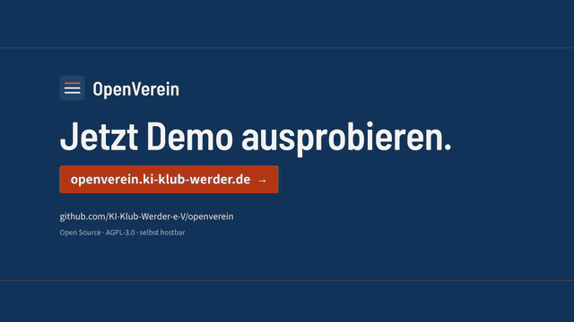

<div align="center">

# OpenVerein

**Vereinsverwaltung für den eingetragenen Verein: offen, selbst gehostet, komplett exportierbar.**

[](https://github.com/KI-Klub-Werder-e-V/openverein/actions/workflows/ci.yml)
[](LICENSE)
[](package.json)
[](openspec/)

[Demo ausprobieren](#demo-ausprobieren) · [Funktionen](#was-openverein-kann) · [Lokal starten](#lokal-starten) · [Mit Claude Code verbinden](#mit-claude-code-verbinden) · [Mitmachen](#mitmachen)

<a href="docs/media/openverein-erklaert.mp4">
  
</a>

<sub>Klick aufs Bild für das Video in voller Auflösung. Die interaktive Fassung liegt in <code>docs/media/erklaervideo/index.html</code>.</sub>

</div>

Open-Source-Vereinsverwaltung für eingetragene Vereine (e.V.): Mitglieder, Gruppen, Beiträge und Rechnungen, SEPA-Lastschrift, Buchhaltung, Termine, Mail, Dokumente und ein Mitgliederportal. Du kannst alles selbst hosten, jeden Datensatz exportieren und jede Aktion auch über die REST-API ausführen.

Lizenz: [AGPL-3.0](LICENSE). Status: frühe Entwicklung, Stück für Stück gebaut (siehe `openspec/`).

## Warum OpenVerein?

- **Deine Daten bleiben bei Dir.** Selbst gehostet, vollständiger Export, keine Abo-Falle.
- **Gemacht für deutsches Vereinsrecht.** EÜR, GoBD, SEPA, XRechnung, Zuwendungsbestätigungen nach BMF-Muster, DATEV-Export.
- **Alles per API.** Die Oberfläche nutzt nur die öffentliche `/api/v1`, mit OpenAPI-Dokumentation, Webhooks und MCP-Anbindung für KI-Agenten.
- **Frei.** AGPL-3.0, offen entwickelt, Beiträge willkommen.

## Inhalt

- [Was OpenVerein kann](#was-openverein-kann)
- [Demo ausprobieren](#demo-ausprobieren)
- [Lokal starten](#lokal-starten)
- [Für den Verein](#für-den-verein)
- [Mit Claude Code verbinden](#mit-claude-code-verbinden)
- [Auf einem Server betreiben](#auf-einem-server-betreiben)
- [Tests](#tests)
- [Wie das Projekt aufgebaut ist](#wie-das-projekt-aufgebaut-ist)
- [Mitmachen](#mitmachen)

## Was OpenVerein kann

| Bereich | Highlights |
|---|---|
| Mitglieder | Gruppenmitgliedschaften mit Datum, Haushalte mit Zahler und Familienrabatt, eigene Felder, Dubletten, gespeicherte Ansichten, Massenaktionen, altersabhängiger Gruppenwechsel, Bestandserhebung für den Landessportbund, Ehrungsregister und Glückwunschmails, Kontaktprotokoll, Hinweise zur Datenqualität, Arbeitsstunden, Mitgliedsbescheinigungen, Listen als PDF und vCard |
| Geld | Beiträge mit Gültigkeitsdatum und Altersstaffeln, verpflichtende Vorschau vor jedem Beitragslauf und optional eine automatische Monatsvorschau, Angebote, die zu Rechnungen werden, Rechnungen mit Standardtexten und Netto- oder Bruttopreisen, Mahnwesen mit Briefen, SEPA-Lastschrift (Vorlage für den Verwendungszweck) und Überweisungen, CAMT-Import mit Zuordnung, XRechnung ausgehend und eingehend (ZUGFeRD/UBL/CII), Artikelkatalog, Briefe als ein Duplex-PDF |
| Bücher | Einnahmen-Überschuss-Rechnung (EÜR) auf einem ausgeglichenen Journal, an das nur angehängt wird (GoBD-Festschreibung, Stornos), Belege und Kassenbuch, Kontobewegungen sammeln und buchen, eigene Steuersätze, DATEV-Export, Kassenbericht als PDF, Soll-Ist-Vergleich, Ehrenamtspauschalen, Spenden und Zuwendungsbestätigungen nach BMF-Muster (Geld- und Sachspenden) per Mail oder Brief |
| Vereinsleben | Termine mit Zu- und Absagen, Warteliste und Anwesenheitslisten für Fördermittel, ICS-Feed und -Import, öffentliches Kalender-Widget, Mail mit Vorlagen und Versandprotokoll, Dokumente mit Ordnerrechten, Inventar und Verleih, Umfragen, Aufgaben, Mitgliederversammlungen und Vorstandssitzungen mit Protokoll |
| Portal | Selbstbedienung für Mitglieder: Datenänderungen, Rechnungen mit GiroCode, Dokumente, Umfragen, Auslagenerstattung, Haushaltsvertretung für den Zahler, Funktionen pro Verein und Gruppe schaltbar |
| Plattform | Rollen mit Spartenbezug und Feldbeschränkungen, TOTP für die Finanzen, API-Tokens und OpenAPI, signierte Webhooks, Hintergrundjobs, Komplettexport, DSGVO-Werkzeuge, `ovctl` für Installation, Backup, Wiederherstellung und Update |

## Demo ausprobieren

> **Ohne Installation:** Die öffentliche Demo läuft unter **https://klub2.ki-klub-werder.de**. Sie wird regelmäßig zurückgesetzt, verschickt keine echten Mails und enthält nur erfundene Daten.

Lokal lädst Du den Demoverein so:

```sh
npm run seed:demo    # lädt den „SV Lindenhof 1921 e.V.“ mit 150 erfundenen Mitgliedern in eine leere Instanz
npm run dev
```

Melde Dich mit `demo@openverein.example` / `verein-demo-2026` an. `npm run seed:demo -- --reset` leert eine Demo-Instanz und lädt sie neu; eine Instanz mit einem echten Verein fasst der Befehl nicht an.

Mit `DEMO_MODE=true` lädt der Server die Demo selbst und setzt sie alle `DEMO_RESET_HOURS` (Standard 24) zurück. Er verschickt dann keine echten Mails, zeigt ein Demo-Banner, versieht jedes PDF mit einem Wasserzeichen und sperrt Konten, Rollen, API-Schlüssel, Uploads und Importe, damit eine öffentliche Demo für alle nutzbar bleibt. Vereinseinstellungen, Texte und Mitglieder können Besucher bis zum nächsten Zurücksetzen bearbeiten. Das Mitgliederportal zeigt den Anmeldecode auf dem Bildschirm, statt ihn zu mailen. Auf einer Instanz mit einem echten Verein startet ein Server mit `DEMO_MODE=true` nicht:

```sh
DEMO_MODE=true docker compose --profile app up --build
```

## Lokal starten

Voraussetzungen: Node 24, Docker.

```sh
cp .env.example .env
npm install
npm run dev
```

`npm run dev` startet Postgres und Mailpit in Docker, spielt die Migrationen ein und startet die API auf http://localhost:3300 und die Web-App auf http://localhost:5173. Beim ersten Aufruf richtest Du Deinen Verein ein. Mails, die die App verschickt, landen in Mailpit unter http://localhost:18025.

API-Referenz: http://localhost:3300/api/docs (OpenAPI-Dokument unter `/api/v1/openapi.json`).

### Die ganze App in Docker

```sh
docker compose --profile app up --build
```

Dann http://localhost:3300 öffnen.

## Für den Verein

- [Handbuch für die Kasse](docs/handbuch-kasse.md): ein Vereinsjahr von den Beiträgen bis zur Steuerberatung.
- [Handbuch für Vorstand und Verwaltung](docs/handbuch-verwaltung.md): Mitglieder, Aufnahme, Termine, Mail, Portal und Datenschutz.
- [Verfahrensdokumentation (Vorlage)](docs/verfahrensdokumentation.md): Vorlage für die GoBD-Verfahrensdokumentation zum Ausfüllen.

## Mit Claude Code verbinden

Das Plugin verbindet Claude Code über den Remote-MCP-Server unter `<club>/mcp` mit einem Verein. Dein Agent sieht und tut genau das, was Du in der Vereinsverwaltung oder im Mitgliederportal siehst und tust, nicht mehr.

1. Installiere das Plugin in Claude Code:

   ```
   /plugin marketplace add KI-Klub-Werder-e-V/openverein
   /plugin install openverein@openverein
   ```

   Ab Claude Code 2.1.275 geht das auch in einem Schritt: `/plugin install openverein --marketplace KI-Klub-Werder-e-V/openverein`.

2. Gib die Adresse Deines Vereins ein, wenn Du danach gefragt wirst, zum Beispiel `https://verein.example.org`. Für die öffentliche Demo gibst Du `https://klub2.ki-klub-werder.de` ein. Später änderst Du die Adresse mit `/plugin configure openverein@openverein`; danach meldest Du Dich neu an. In der Shell gibst Du die Adresse direkt beim Installieren mit: `claude plugin install openverein@openverein --config club_url=https://verein.example.org`.

3. Anmelden: Führe `/mcp` aus, wähle `openverein` und authentifiziere Dich. Im Browser gilt:
   - Mitglieder melden sich mit ihrem E-Mail-Code im Portal an
   - die Vereinsverwaltung meldet sich mit ihrem normalen Login und zweitem Faktor an

   Prüfe vor der Anmeldung, dass der Browser die Adresse Deines Vereins zeigt. Wähle dann „nur lesen“ oder „lesen und schreiben“ und erlaube den Zugriff. Dabei landet kein Token in irgendeiner Datei.

4. Frag zum Beispiel: „Welche Rechnungen sind bei mir offen?“ oder „Wer hat sich für das Training am Dienstag angemeldet?“.

Die Aufrufe des Agenten siehst Du unter **Einstellungen → Agenten** (oder **Portal → Agenten**), dort kannst Du ihm den Zugriff auch wieder entziehen. Skripte und das Kommandozeilenwerkzeug `ov` nutzen statt OAuth ein Token von derselben Seite. claude.ai und ChatGPT verbinden sich als benutzerdefinierter Connector mit derselben Adresse `<club>/mcp`.

## Auf einem Server betreiben

`./ovctl install` richtet Caddy (HTTPS), die App und Postgres mit Docker Compose ein; `./ovctl backup`, `restore`, `update` und `doctor` halten alles am Laufen. Details in [docs/operations.md](docs/operations.md).

## Tests

```sh
npm run typecheck && npm run lint
npm test            # Unit- und Integrationstests (braucht den Postgres-Container)
npm run test:e2e    # End-to-End-Tests mit Playwright
npm run validate:xrechnung  # Beispiel-E-Rechnungen durch den offiziellen KoSIT-Validator (braucht Java 17+ oder Docker)
```

## Wie das Projekt aufgebaut ist

- `openspec/specs/` ist die verbindliche Beschreibung des Verhaltens, eine Spezifikation pro Fähigkeit. Jedes Stück entsteht über einen OpenSpec-Change in `openspec/changes/` und wird nach dem Merge archiviert.
- `src/server/` Fastify-API, `src/web/` React-App, `src/shared/` gemeinsame Schemas für beide, `migrations/` SQL-Migrationen, die nur vorwärts laufen.
- `docs/adr/` Architekturentscheidungen, `docs/decisions.md` kleinere Entscheidungen.
- `PRODUCT.md` und `DESIGN.md` beschreiben das Produkt und das Designsystem.
- `android/`, `ios/`, `capacitor.config.ts`, `codemagic.yaml`: mobile Apps, die den Web-Build einpacken, siehe [docs/mobile.md](docs/mobile.md).

## Mitmachen

Beiträge sind willkommen, ob Fehlerbericht, Funktionswunsch, Doku oder Code.

- [CONTRIBUTING.md](CONTRIBUTING.md): Einrichtung, Arbeitsweise mit OpenSpec, Regeln und PR-Checkliste.
- [SECURITY.md](SECURITY.md): Sicherheitslücken bitte vertraulich melden, nicht als öffentliches Issue.
- [CODE_OF_CONDUCT.md](CODE_OF_CONDUCT.md): unser Verhaltenskodex.
- [Issues](https://github.com/KI-Klub-Werder-e-V/openverein/issues): Fehler melden oder Funktionen vorschlagen.
